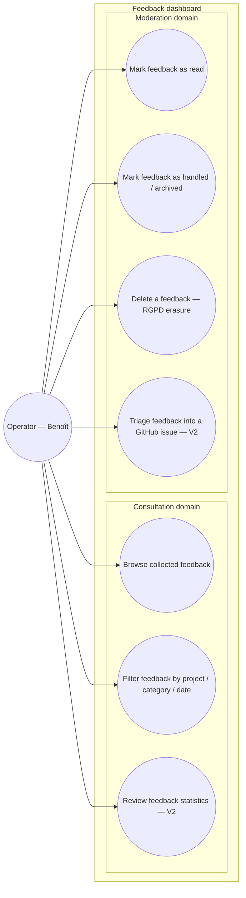

# Use-case diagram — feedback-dashboard — who consults what

> **Feature**: feedback dashboard (centralized consultation).
> **Source spec**: [`../../specs/feedback-dashboard.md`](../../specs/feedback-dashboard.md).

## Context

Who interacts with the dashboard and to do what. One actor (the operator).
Grouped by **domain** (Consultation, Moderation), not by where it runs. The daily
Telegram digest is **not** here — a scheduled push is a trigger, not an
actor-initiated goal (see [`../feedback-pipeline/04-sequence-digest.md`](../feedback-pipeline/04-sequence-digest.md)).

## Diagram

## Notes

- **V1** = UC1–UC5. **V2** = UC6 (triage) + UC7 (stats).
- UC6 *"Triage into a GitHub issue"* is operator-initiated (the operator decides
  and acts) — it is a valid use case. It is the **same** goal whether triggered
  from this dashboard or from Telegram; one service backs both (spec D4).
- The Telegram **digest** is deliberately absent: receiving a notification is a
  trigger, not a goal (UML 2.5 / Cockburn).
- Single actor today (spec: no tenancy / YAGNI on the agency multi-tenant case).
