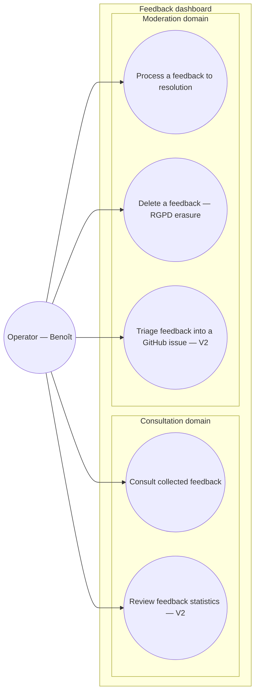

# Use-case diagram — feedback-dashboard — who consults what

> **Feature**: feedback dashboard (centralized consultation).
> **Source spec**: [`../../specs/feedback-dashboard.md`](../../specs/feedback-dashboard.md).

## Context

Who interacts with the dashboard and to do what. One actor (the operator). Use
cases are kept at **user-goal level** (Cockburn): filtering, marking read, and
marking handled are **steps** inside these goals, not use cases of their own.
Grouped by **domain** (Consultation, Moderation), not by where it runs. The daily
Telegram digest is **not** here — a scheduled push is a trigger, not a goal.

## Diagram

## Notes

- **V1** = UC1, UC3, UC4. **V2** = UC2 (stats) + UC5 (triage).
- **Steps folded into goals** (not separate use cases): _filter by
  project/category/date_ and _mark read_ are steps of UC1/UC3; _mark
  handled/archived_ is the closing step of UC3.
- UC5 _"Triage into a GitHub issue"_ is operator-initiated and is the **same**
  goal whether triggered from this dashboard or from Telegram; one service backs
  both (spec D4).
- The Telegram **digest** is deliberately absent: receiving a notification is a
  trigger, not a goal (UML 2.5 / Cockburn).
- Single actor today (spec: no tenancy / YAGNI on the agency multi-tenant case).
