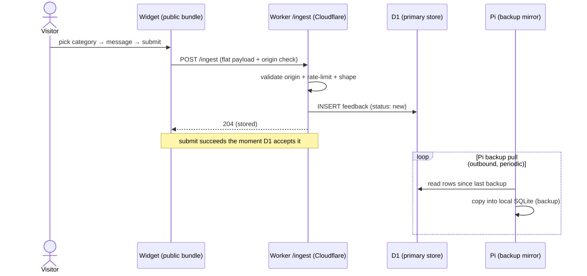

# Sequence diagram — feedback-dashboard — feedback ingestion into D1

> **Feature**: feedback dashboard.
> **Source spec**: [`../../specs/feedback-dashboard.md`](../../specs/feedback-dashboard.md) §D1–D2, D5.

## Context

What happens when a visitor submits feedback, under the edge-centric model:
`/ingest` writes **directly to D1** (no KV buffer); the Pi later pulls a backup
copy. Does not cover validation detail (see the Worker spec).

## Diagram

## Notes

- D1 is the **primary** store and is written synchronously before the `204`.
- The Pi only **copies** — it is a backup, never on the submit path (spec D5).
- The Pi reaches D1 **outbound** (Cloudflare API / a Worker drain route); nothing
  connects into the Pi (Tailscale-only home).
- Replaces the previous KV-buffer + Pi-as-source-of-truth flow.
