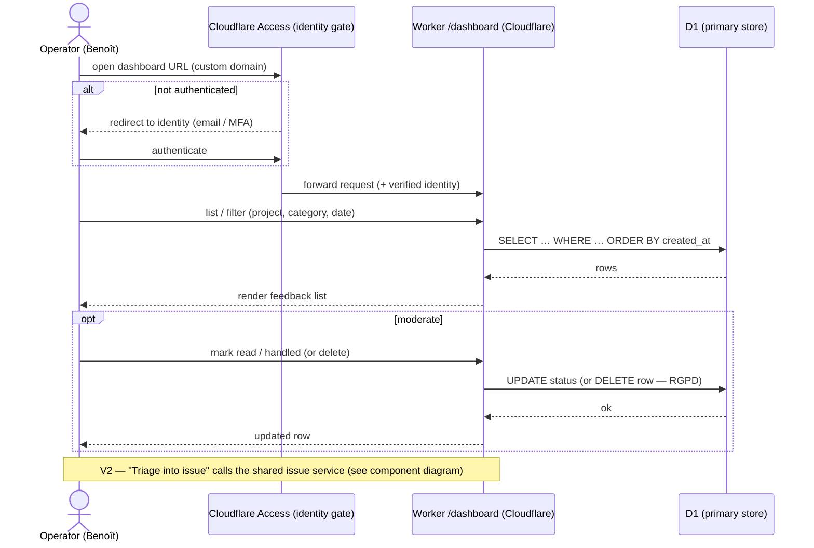

# Sequence diagram — feedback-dashboard — consult + moderate (auth)

> **Feature**: feedback dashboard.
> **Source spec**: [`../../specs/feedback-dashboard.md`](../../specs/feedback-dashboard.md) §D3, D6–D8.

## Context

The operator opens the dashboard (gated by Cloudflare Access), lists/filters
feedback, and moderates (delete / mark). Shows the **Access** gate in front of
the Worker. V2 triage is noted but not detailed here.

## Diagram

## Notes

- **Cloudflare Access sits in front of the Worker** — auth is enforced at the
  edge before any request reaches the dashboard code (spec D6). Requires the
  custom domain.
- `DELETE` is a hard delete (RGPD right-to-erasure, spec D7).
- `status` is the single field shared with the V2 triage (spec D8) — no
  competing state.
