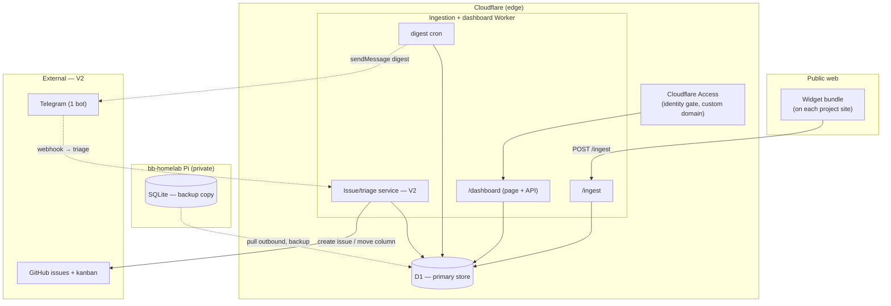

# Component diagram — feedback-dashboard — edge-centric structure

> **Feature**: feedback dashboard.
> **Source spec**: [`../../specs/feedback-dashboard.md`](../../specs/feedback-dashboard.md) §D1–D6.

## Context

Structural boundaries under the edge-centric model: the **brain and the primary
store live on Cloudflare**; the Pi is a backup copy; GitHub/Telegram are V2
triggers/targets. Supersedes the Pi-as-brain layout of
[`../feedback-pipeline/03-component.md`](../feedback-pipeline/03-component.md).

## Diagram

## Notes

- **Single primary store = D1** on the edge. The Pi `SQLite` is a **backup
  copy** pulled outbound — dashed, off the critical path (spec D5).
- **Access gates `/dashboard` only** (identity); `/ingest` stays public with
  origin filter + rate-limit (it must accept anonymous visitor submits).
- **One triage service** on the Worker, reached by the dashboard (V2 button) and
  by Telegram (V2 **webhook**) — no duplicate triage logic (spec D4).
- The **digest cron** and **triage service** are V2; drawn here so the V1
  boundaries (Ingest + Dash + D1 + Access) are clearly the subset to build first.
- SOLID/DIP: the triage service depends on abstract ports (`IssueTracker`,
  `NotificationChannel`); GitHub/Telegram are edge adapters — swap an adapter,
  not the service.
