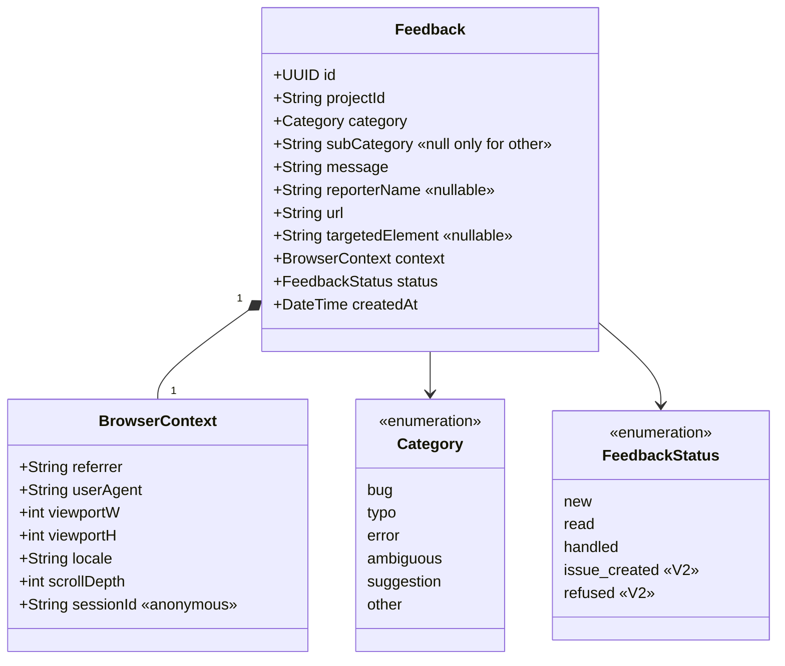

# Class diagram — feedback-dashboard — the Feedback record

> **Feature**: feedback dashboard.
> **Source spec**: [`../../specs/feedback-dashboard.md`](../../specs/feedback-dashboard.md) §D9.

## Context

The stored Feedback record — the D1 schema. Designed **stats-ready** (every
column the wanted V2 stats need: project, category, date, url, targeted
element). Does not show DB indexes.

## Diagram

## Notes

- Mirrors the widget→Worker payload (spec: contract unchanged) plus two stored
  fields: `status` (mutable, spec D8) and `createdAt` (digest + trend stats).
- **Stats-ready** (spec D9): `projectId`, `category`/`subCategory`, `createdAt`,
  `url`/`targetedElement` cover all four wanted stats with `GROUP BY`. No schema
  rework when stats land in V2.
- `BrowserContext` may be stored inline (columns) or as JSON; either keeps the
  raw payload authoritative ([`project_worker_contract_coupling`] in memory).
- `sessionId` is anonymous (no account) — see the data-flow diagram for PII.
