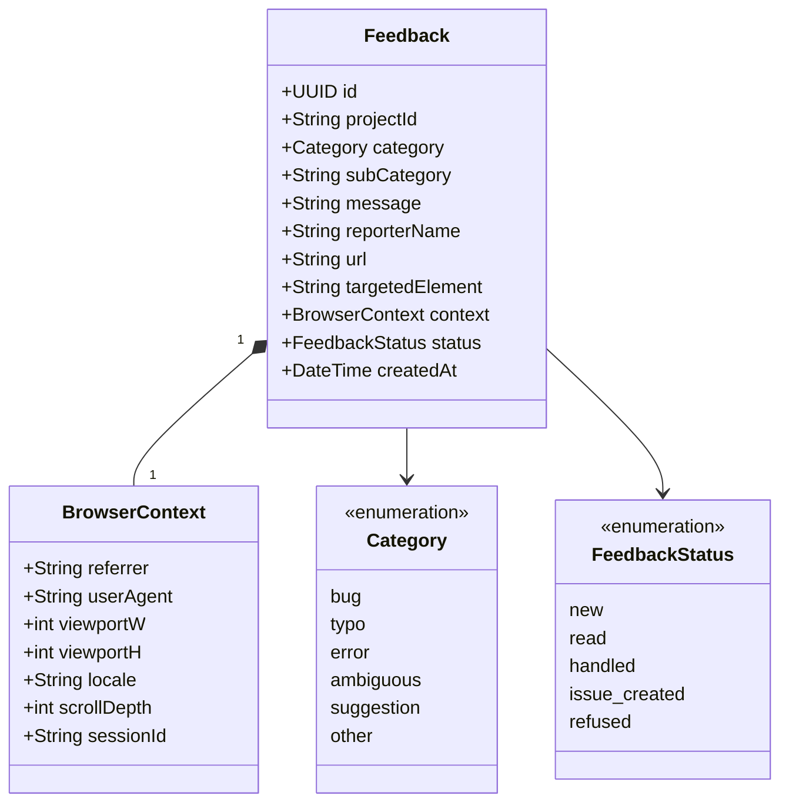

# Class diagram — feedback-dashboard — the Feedback record

> **Feature**: feedback dashboard.
> **Source spec**: [`../../specs/feedback-dashboard.md`](../../specs/feedback-dashboard.md) §D9.

## Context

The stored Feedback record — the D1 schema. Designed **stats-ready** (every
column the wanted V2 stats need: project, category, date, url, targeted
element). Does not show DB indexes. Field nuances (nullability, V2-only values)
are in the Notes, not inline, to keep the Mermaid clean.

## Diagram

## Notes

- **Nullable fields**: `subCategory` is null only for `category = other`;
  `reporterName` and `targetedElement` are optional.
- **V2-only statuses**: `issue_created` and `refused` are set by the V2 triage;
  V1 uses only `new`, `read`, `handled`. See
  [`05-state-feedback.md`](./05-state-feedback.md).
- Mirrors the widget→Worker payload (spec: contract unchanged) plus two stored
  fields: `status` (mutable, spec D8) and `createdAt` (digest + trend stats).
- **Naming**: this conceptual model uses camelCase (`createdAt`, `subCategory`);
  the **D1 columns use snake_case** (`created_at`, `sub_category`) as the SQL
  queries in the spec/sequence diagrams show. One field, two casings by layer.
- **Stats-ready** (spec D9): `projectId`, `category`/`subCategory`, `createdAt`,
  `url`/`targetedElement` cover all four wanted stats with `GROUP BY`. No schema
  rework when stats land in V2.
- `BrowserContext` may be stored inline (columns) or as JSON; either keeps the
  raw payload authoritative — the payload-coupling rule with the Worker (see
  [`feedback-pipeline-worker.md`](../../specs/feedback-pipeline-worker.md)).
- `sessionId` is anonymous (no account) — see the data-flow diagram for PII.
