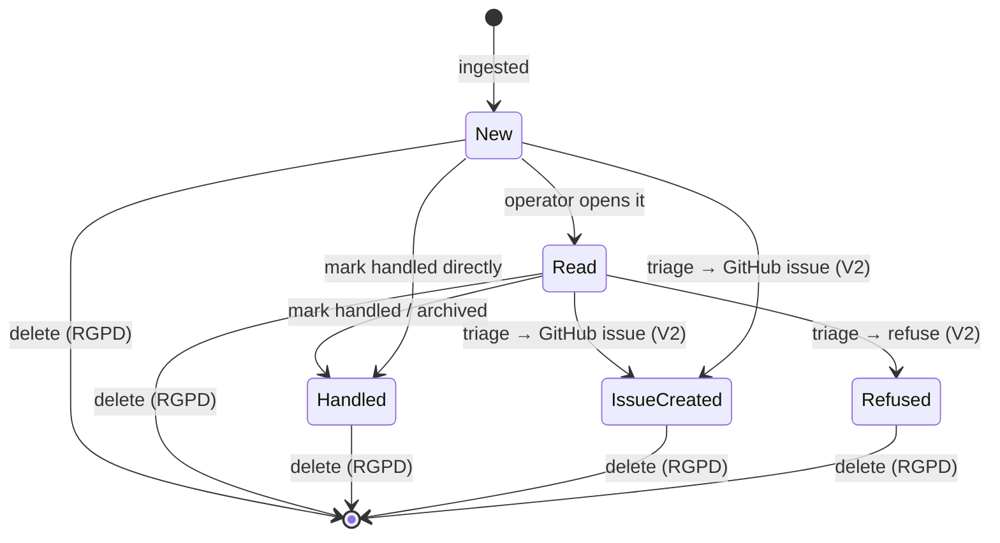

# State diagram — feedback-dashboard — feedback lifecycle

> **Feature**: feedback dashboard.
> **Source spec**: [`../../specs/feedback-dashboard.md`](../../specs/feedback-dashboard.md) §D7–D8.

## Context

The lifecycle of one feedback through the `status` field. V1 covers
`new → read → handled` + delete; V2 adds the triage outcomes. One field, written
by both the dashboard and (V2) the Telegram triage.

## Diagram

## Notes

- **V1 states**: `New`, `Read`, `Handled`. Delete (RGPD) is reachable from any
  state (spec D7) and is a **hard delete** (terminal).
- **V2 states**: `IssueCreated` (triaged → kanban) and `Refused` — set by the
  shared triage service whether triggered from the dashboard or Telegram
  (spec D4/D8), so the lifecycle is identical across both entry points.
- No "unread" state is modeled separately; "mark unread" is `Read → New`
  (omitted from the diagram for readability).
- **State labels ↔ stored values**: the TitleCase states map 1:1 to the
  lowercase `status` enum in the class diagram —
  `New→new`, `Read→read`, `Handled→handled`, `IssueCreated→issue_created`,
  `Refused→refused`. The diagram uses TitleCase for readability; the stored
  values are the lowercase enum (see [`04-class.md`](./04-class.md)).
