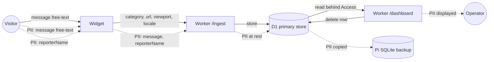

# Data-flow diagram — feedback-dashboard — PII trail

> **Feature**: feedback dashboard.
> **Source spec**: [`../../specs/feedback-dashboard.md`](../../specs/feedback-dashboard.md) §D6–D7.

## Context

Where feedback data flows and which fields carry personal data (RGPD). Forces the
privacy controls to be explicit: the dashboard exposing this data is **why**
Cloudflare Access is mandatory.

## Diagram

## Notes

- **PII-bearing edges** flagged: `message` (free text — may contain anything),
  `reporterName`. `url` can be quasi-identifying; `sessionId` is anonymous.
- The dashboard **displays PII** → access **must** be gated (spec D6: Cloudflare
  Access). This diagram is the justification for that control.
- **At rest in two places**: D1 (primary) and the Pi backup — both hold PII, so
  both inherit the deletion duty. An RGPD delete must propagate to the backup
  (the Pi backup is a mirror → the deleted row stops being copied; document the
  backup-retention window).
- No third-party processor in V1. V2 adds GitHub (issue body) + Telegram (message
  text) — those edges will carry PII and must be added to this diagram then.
