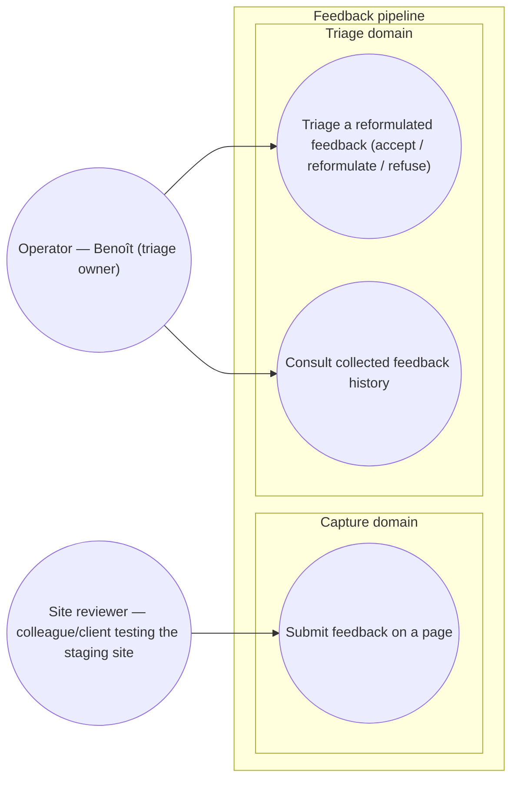

# Use-case diagram — feedback-pipeline — who interacts and to do what

> **Feature**: feedback consumer pipeline (staging-gated delivery +
> agentic Telegram triage). Design locked 2026-05-21 (decisions Q1–Q8).
> **Source specs**: [`.github/design/n8n-pipeline.md`](../../../../.github/design/n8n-pipeline.md)
> (superseded ingestion approach — see banner there),
> [`.github/design/projects-yaml-schema.md`](../../../../.github/design/projects-yaml-schema.md)
> (category taxonomy + per-project routing contract).

## Context

This diagram answers _"who wants what?"_ for the feedback pipeline. It
covers the two human actors and their goals — not how the system is
structured (see `03-component.md`) nor the runtime order (see
`02-sequence.md`). External systems (Claude API, Telegram, GitHub) are
supporting actors, never primary initiators.

## Diagram

## Notes

- **`Submit feedback on a page`** is the only Reviewer goal: pick a
  top-level category → sub-category (progressive disclosure) → free-text
  message → submit. Auto-capture (url, viewport, …) happens without a
  user action, so it is not a use case.
- **`Triage a reformulated feedback`** is the Operator acting on a
  Telegram proposal. Modelled as one use case (one decision interaction)
  with three observable outcomes: Accept → GitHub issue in **To Do**;
  Reformulate → issue in **Backlog** + needs-reformulation labels;
  Refuse → kept in the HDD store with `status: refused`. _"Receive a
  Telegram notification"_ is deliberately **not** a use case — it is a
  trigger; the goal is the triage decision the operator initiates.
- **`Consult collected feedback history`** — the Operator can review all
  feedback (including refused) from the store; supports audit + stats.
- External systems (Claude API for reformulation, Telegram for the
  triage channel, GitHub for issues/kanban) are supporting actors of the
  triage use case, not primary actors — they never initiate a goal.
- Open: an external client (vs internal colleague) becomes a distinct
  Reviewer persona only in the future "agency" multi-tenant scope (out
  of scope for the brasse-bouillon-first build).
