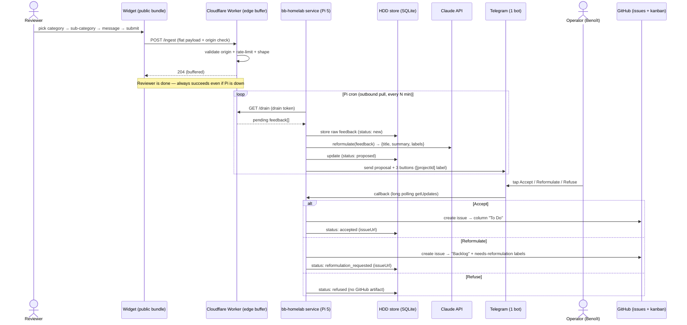

# Sequence diagram — feedback-pipeline — end-to-end flow

> **Feature**: feedback consumer pipeline. Design locked 2026-05-21
> (Q1–Q8).
> **Companion**: [`01-use-case.md`](./01-use-case.md),
> [`03-component.md`](./03-component.md).

## Context

This diagram shows what happens _in time_ for one feedback, from the
reviewer's submit to the GitHub issue. It makes the **edge-buffer +
outbound-pull** boundary explicit (the Pi never receives an inbound
public connection) and the **human-in-the-loop** triage step. It does
not cover error/retry detail (widget outbox, Worker retries) — those
live in the component notes.

## Diagram

## Notes

- The `204 (buffered)` reply is the key reliability property: the
  reviewer's submit succeeds the moment the **edge** accepts it; the Pi
  being down or unstable never blocks the reviewer (it catches up on the
  next pull).
- Every arrow from `Pi` is **outbound** (Pi → CF, Pi → Claude, Pi → TG,
  Pi → GH). Nothing connects _into_ the Pi — imposed by the Tailscale-
  only homelab (no public ingress). Telegram callbacks arrive via
  **long polling** (`getUpdates`), not a webhook, for the same reason.
- The HDD store is written at every state transition → it is the single
  source of truth. The GitHub issue is created only on Accept /
  Reformulate; Refuse leaves only the store record.
- The single Claude API call is the only AI step (reformulation). No
  autonomous agent loop (deterministic flow → Agent SDK is YAGNI).
- Routing to the right repo/kanban uses `projectId` from the payload
  (one bot, many projects).
