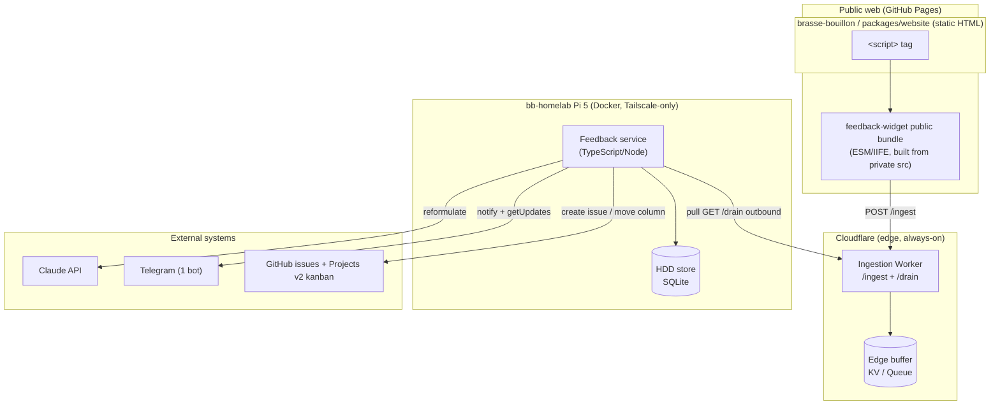

# Component diagram — feedback-pipeline — structural boundaries

> ⚠️ **Partially superseded (2026-05-24).** This shows the original Pi-as-brain
> model (KV buffer + Pi as source of truth running Claude/Telegram/GitHub). The
> **edge-centric pivot** made Cloudflare D1 the primary store and the Worker the
> brain; the Pi is now only a backup mirror. The current structure is
> [`../feedback-dashboard/03-component.md`](../feedback-dashboard/03-component.md).
> Kept for history; do not treat as current.

> **Feature**: feedback consumer pipeline. Design locked 2026-05-21
> (Q1–Q8).
> **Companion**: [`01-use-case.md`](./01-use-case.md),
> [`02-sequence.md`](./02-sequence.md).

## Context

This diagram shows the structural boundaries and dependencies — which
component lives where, across the three repos + the edge + the homelab.
It makes the egress/ingress boundary explicit (the only public surface
is the Worker; the Pi is outbound-only). It does not show timing (see
`02-sequence.md`).

## Diagram

## Notes

- **Single public surface = the Worker.** Everything else the Pi does is
  **outbound** (pull, Claude, Telegram, GitHub). The Pi exposes no
  inbound port — imposed by the Tailscale-only homelab (no public
  domain; this is a `bb-homelab` repo infrastructure decision, distinct
  from this pipeline's Q1–Q8 design decisions).
- **Three repos**: the widget bundle is built in `feedback-widget`
  (private source, public compiled artifact); the Worker is a new
  dedicated repo (its own CI/tests per conventions); the `<script>`
  integration lives in `brasse-bouillon/packages/website`. The Pi
  service is deployed from `bb-homelab` (Docker).
- **Ports/adapters mapping** (SOLID/DIP): the Pi feedback service holds
  abstract ports — `ConfigSource` (projectId → repo/kanban/labels),
  `LLMGateway` (Claude adapter), `NotificationChannel` (Telegram
  adapter, bidirectional), `IssueTracker` (GitHub adapter). Swapping any
  edge system = swap an adapter, not the orchestration.
- **Secrets boundary**: ingest token sits in the public bundle and is
  therefore low-value by design (real protection = origin allowlist +
  rate-limit on the Worker). The drain token, Claude API key, Telegram
  bot token, and GitHub PAT live only in Worker secrets / Pi service
  config — never in the public site or in chat.
- **V1 vs V2**: V1 = bundle + Worker + Pi store (feedback lands).
  V2 = the Claude / Telegram / GitHub adapters (the triage layer). The
  store is the seam: V2 plugs in by reading it, no V1 rework.
