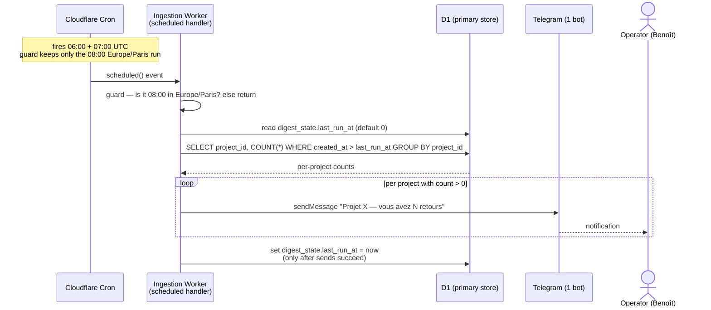

# Sequence diagram — feedback-pipeline — daily Telegram digest

> **Feature**: scheduled per-project feedback digest (Telegram, send-only).
> **Design locked 2026-05-23; reconciled to the edge-centric pivot 2026-05-24.**
> **Companion**: [`02-sequence.md`](./02-sequence.md),
> [`03-component.md`](./03-component.md),
> [`../feedback-dashboard/03-component.md`](../feedback-dashboard/03-component.md).

## Context

A daily push: every morning at **08:00 Europe/Paris**, the operator receives
**one Telegram message per project that got new feedback** since the previous
digest — _"Projet X — vous avez N retours"_. A project with zero new feedback
gets **no message**.

This is **send-only** (no triage buttons — that is the V2 flow). It runs on the
**Cloudflare Worker** (a Cron Trigger), not on the Pi: a clock-triggered push
must live on the always-on edge, not the unstable home Pi, and the feedback is
already in **D1** on the Worker.

Counting is **"new since the last digest"**, queried from **D1** by
`created_at` — not "all pending" (which would re-report the same items every
morning).

## Diagram

## Notes

- **Host = the edge, on purpose.** The Worker is always-on; the Pi has known
  heartbeat instability, so a time-triggered job is more reliable on Cloudflare.
  The data is already in D1 — no transfer needed. See
  [`../feedback-dashboard/03-component.md`](../feedback-dashboard/03-component.md).
- **Timezone**: Cloudflare cron is UTC; 08:00 Paris is 07:00 UTC (CET, winter)
  or 06:00 UTC (CEST, summer). Two cron entries (`0 6` + `0 7`) plus a
  `Europe/Paris == 08:00` guard fire exactly once/day year-round.
- **Counting = new since last digest**, from D1 by `created_at`. The
  `last_run_at` advances **only after** the sends succeed → a Telegram outage
  just defers the count to the next morning (no loss, no double count). D1 is the
  durable source of truth, so the count is exact (no KV cursor, no Pi-drain
  coexistence caveat — the Pi only backs D1 up, never deletes from it).
- **Zero-count projects are skipped** — no message, per the requirement.
- **Not a use case** (UML): a scheduled push is a system-initiated trigger, not
  an actor-initiated goal, so it adds no node to
  [`01-use-case.md`](./01-use-case.md) — this sequence is the right artifact.
- **Secrets**: `TELEGRAM_BOT_TOKEN` + `TELEGRAM_CHAT_ID` are Worker secrets,
  never in the repo or chat.
