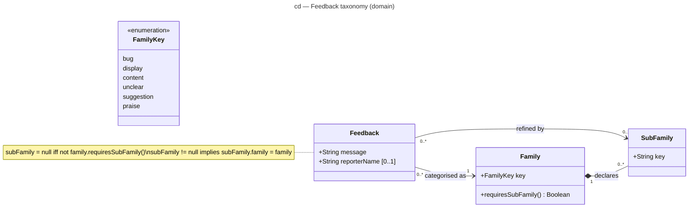

# Class diagram — feedback taxonomy — families and sub-families (domain)

> **Feature**: issue #128 — richer feedback families and guided sub-families
> **Source spec**: [`../../specs/feedback-taxonomy.md`](../../specs/feedback-taxonomy.md) §D1–D3
> **See also**: [`05-state-widget-session.md`](./05-state-widget-session.md)

## Context

The domain model of one feedback: its family, its sub-family and the free text. The guided prompts (D4) are a view concern in `packages/web` and are deliberately absent; so are the browser context, the target and the transport (unchanged, see `feedback-pipeline/`).

## Diagram

## Notes

- `Family "1" *-- "0..*" SubFamily`: a sub-family key only has meaning under its family (`bug/other` ≠ `content/other`), hence the composition and the `SUB_CATEGORIES_BY_CATEGORY` table as single source in the code. `Family` is a class (not the enumeration) so it can own parts; `FamilyKey` is the closed set `TopLevelCategory`.
- The note carries the pairing constraint enforced by `CategorizedFeedback` and `buildFeedbackPayload`: `praise` declares no sub-family, every other family requires one.
- The priority of `bug/personal-data` (D3) is derived by the Worker from the key; it is not a widget-domain attribute.
- Counts: 6 families, 26 sub-families (was 5 / 13).
