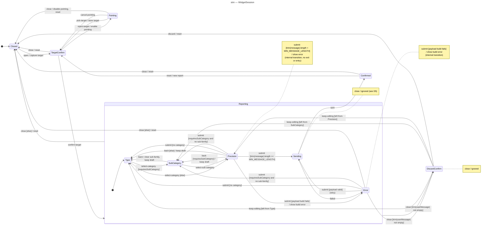

# State diagram — feedback taxonomy — widget session

> **Feature**: issue #128 — richer feedback families and guided sub-families
> **Source spec**: [`../../specs/feedback-taxonomy.md`](../../specs/feedback-taxonomy.md) §D5
> **See also**: [`04-class.md`](./04-class.md)

## Context

The lifecycle of one widget session (`WidgetState.step`), from the trigger click to the confirmation. Existing steps are kept; the change is the new `DiscardConfirm` state, the draft-preserving `back` transitions and the explicit handling of `close` in every state. Guards use the state fields and `requiresSubCategory(selectedCategory)`; `Escape` is `close` everywhere.

## Diagram

## Notes

- `Reporting` is a composite so the two `close` transitions are drawn once. `keep-editing` is a history re-entry (UML `H`); Mermaid has no history pseudostate, so it is drawn as three guarded arrows on a `returnTo` field stored when `DiscardConfirm` is entered. `keep-editing` from `Error` returns to `Precision`.
- The discard guard looks at the draft, not the step: D5 keeps `userMessage` when going back to ③ or ④, so closing there with a draft must ask too.
- `back` never clears `userMessage` or `reporterName` (D5); only `selectedSubCategory` is cleared when the user returns to `Type`.
- The too-short message is an internal transition (note on `Precision`): the step does not change, only `errorMessage`. The code re-renders the shadow DOM in that case; focus restoration is a view concern, not a state one.
- `Error → Sending` is the real retry path: the retry button emits `submit`, and `preparePayload` re-routes to `Type` / `SubCategory` first when a selection is missing (same guards as from `Precision`).
- Today `Confirmed` and `Error` (after transport) are set by the view (`showConfirmation`, `showMailtoFallback`) while the controller's `step` stays `sending`; that split is what lets a late result re-open a closed widget. The change moves both transitions into the controller so `WidgetState.step` is the single source, and `close` during `Sending` is ignored.
- `open` and `reset` are only emitted by the view in `Closed` / `Confirmed`; the controller does not guard them. Documented as view-gated, unchanged.
- There is no final state: the session machine lives as long as the element is mounted; unmount is outside it.
- Enum alignment: `WidgetStep` gains `discard-confirm`; `UserAction` gains `keep-editing` and `discard`. Every other state and trigger already exists under the same name.
- Tests to list in the matrix: one per transition above, plus `close` from `SubCategory` with a non-empty draft (must ask) and `close` during `Sending` followed by a late success (must stay closed).
