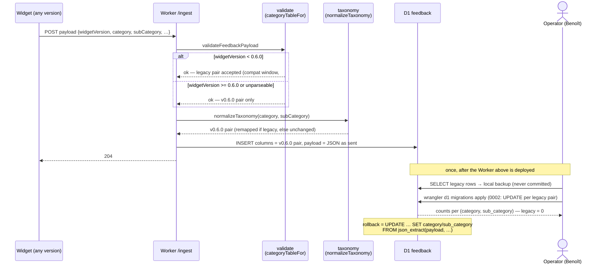

# Sequence diagram — legacy taxonomy remap (feedback-widget#84, option C)

> **Feature**: keep the D1 `category` / `sub_category` columns on the single
> v0.6.0 vocabulary while the Worker still accepts the retired taxonomy from
> pinned widgets (< 0.6.0, see #102).
> **Decision**: [`../../specs/legacy-taxonomy-remap.md`](../../specs/legacy-taxonomy-remap.md).
> **Companion**: [`../feedback-dashboard/02a-sequence-ingest.md`](../feedback-dashboard/02a-sequence-ingest.md).

## Context

Two paths write the taxonomy columns. The **ingest** path normalizes every
accepted payload at write time; the **one-shot migration** normalizes the rows
stored before that normalization existed. Both use the same mapping table, and
neither touches the `payload` JSON column (source of truth), so the remap is
reversible.

## Diagram

## Notes

- The dashboard needs no change: it renders the columns as opaque escaped
  strings and filters by bound equality, so it only ever sees v0.6.0 names.
- The migration is idempotent (its WHERE clauses match legacy pairs only) and
  is replayed in the Worker's integration suite against rows inserted with the
  retired vocabulary.
