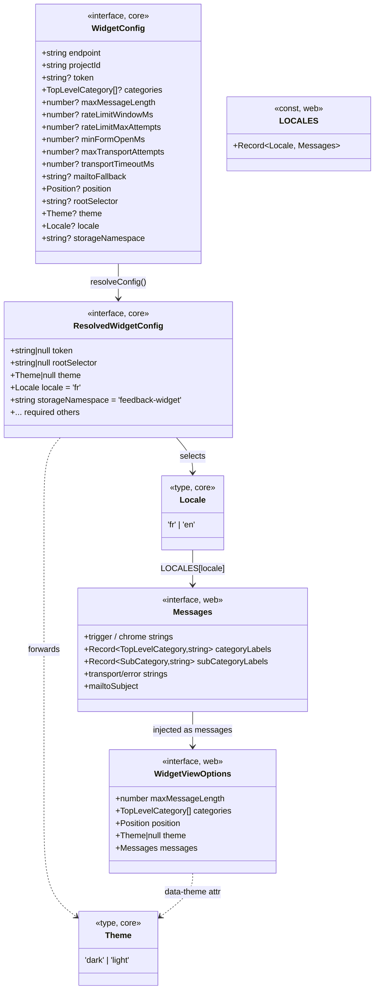
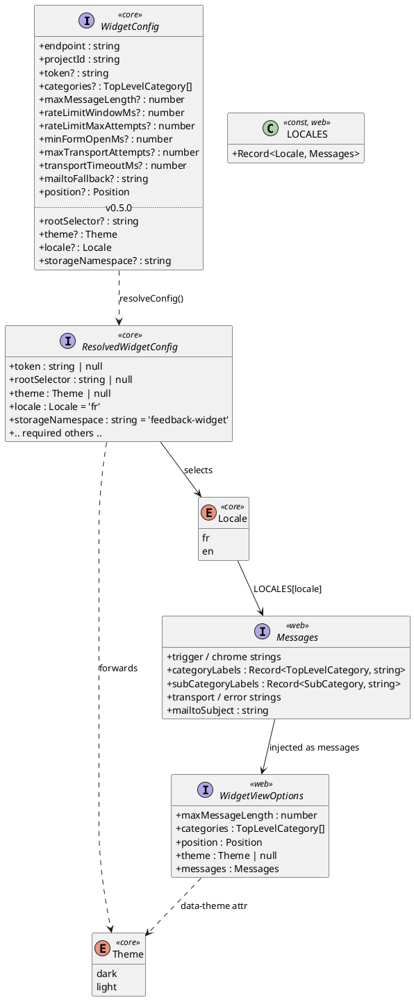

# Class diagram — widget config v0.5.0 — multi-project reusability fields

> **Feature**: v0.5.0 adds four optional, backward-compatible `WidgetConfig`
> fields so the widget can be dropped into any host (not just Impropedia):
> `rootSelector`, `theme`, `locale`, `storageNamespace`.
> **Companion**: [`02-sequence.md`](./02-sequence.md) (mount wiring).

## Context

All four fields are **optional** → adding them is a **MINOR** bump (0.4.0 →
0.5.0). The contract that matters: `ResolvedWidgetConfig` is built by
`resolveConfig`, which **only copies the keys it knows about** — so every new
field must be threaded through `resolveConfig` or it is silently dropped before
reaching the adapters. Nullable fields (no sensible non-null default) join the
`Omit<…>` group alongside `token`; `locale`/`storageNamespace` get real
defaults (`'fr'`, `'feedback-widget'`) that preserve v0.4.0 behaviour.

`Messages` + `LOCALES` are the new i18n seam (web package). The resolved
`locale` selects one `Messages` bundle, which is handed to the view via
`WidgetViewOptions.messages` and used directly by the controller for its
transport/error strings.

## Diagram (Mermaid)

## Diagram (PlantUML)

## Notes

- `rootSelector` is forwarded to `createIntersectionViewportDetector` (web) which
  already defaults it to `'main'` — the default stays in **one** place, so the
  resolved value is `string | null` and the adapter receives `?? undefined`.
- Icons in `categoryLabels`/`subCategoryLabels` stay hardcoded (locale-neutral);
  only the text `label` is translated.
- No field touches `FeedbackPayload` → the Worker ingest contract is unchanged.
