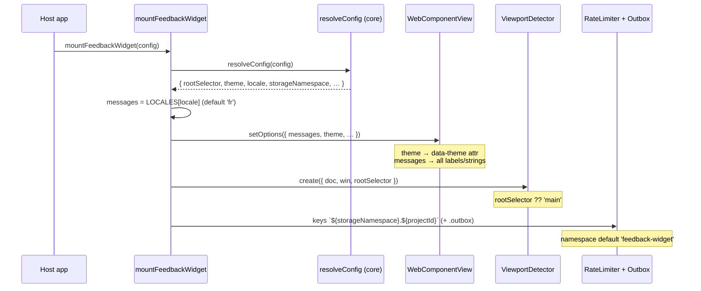
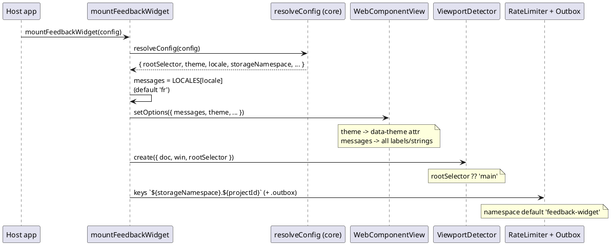

# Sequence diagram — widget config v0.5.0 — mount wiring

> **Feature**: how the four resolved v0.5.0 config fields (`rootSelector`,
> `theme`, `locale`, `storageNamespace`) reach their adapters at mount time.
> **Companion**: [`01-class.md`](./01-class.md).

## Context

`mountFeedbackWidget` is the composition root. After `resolveConfig` fills
defaults, each field is wired to exactly one collaborator:

- `locale` → selects a `Messages` bundle from `LOCALES` (default `'fr'`), handed
  to the view and used by the controller for transport/error strings.
- `theme` → passed to the view, which reflects it as a `data-theme` attribute
  that drives the Shadow-DOM CSS variables (absent/`null` = light, unchanged).
- `rootSelector` → passed to the viewport detector, which still owns the default
  (`?? 'main'`), so the default lives in one place.
- `storageNamespace` → prefixes the rate-limiter and outbox localStorage keys
  (default `'feedback-widget'`, configurable per host). No legacy/branded
  namespace remains in the code.

## Diagram (Mermaid)

## Diagram (PlantUML)

## Notes

- `resolveConfig` is the gatekeeper: a field absent from its mapping is dropped
  before it reaches any collaborator.
- No payload field changes → the Worker ingest contract is unaffected.
